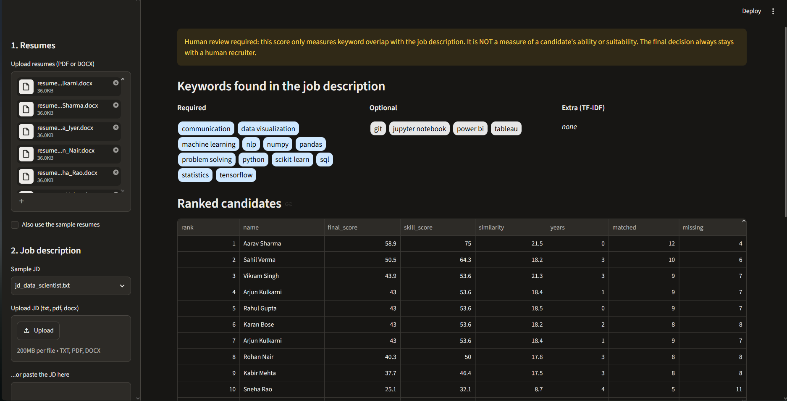
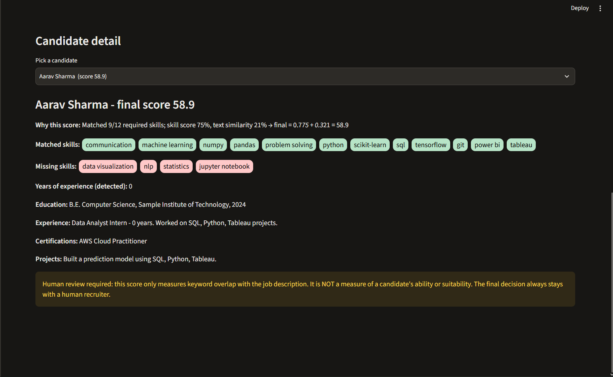

# AI Resume Screening and Candidate Ranking System
 
Reads resumes (PDF/DOCX), extracts keywords from any job description, and ranks candidates
with an explainable match score. A human recruiter always makes the final decision.
 
## Features
- Resume parsing for PDF and DOCX, with text cleaning and clear errors for bad files
- Field extraction: skills, education, experience, certifications, projects
- Keyword extraction from any job description: skills dictionary + TF-IDF phrases
- Explainable score with matched and missing skills shown separately
- Two interfaces: a Streamlit web app and an in-notebook dashboard (both sortable)
- Fairness: name, email, age, gender, photo, religion and caste are never used in scoring
## Project structure
    resume_screening.ipynb   main notebook: builds sample data, writes the modules, tests, dashboard
    extractor.py             module 1: resume extraction (written by the notebook)
    matcher.py               module 2: JD keywords + explainable scoring (written by the notebook)
    app.py                   module 3: Streamlit web interface (written by the notebook)
    sample_data/             15 fictional resumes + 2 job descriptions
    test_report.csv          results of the 13 automated tests
    screenshots/             dashboard and test-report screenshots
    requirements.txt         dependencies
 
## Setup
    pip install -r requirements.txt
1. Open `resume_screening.ipynb`, choose your Python kernel and click **Run All** (top to bottom).
   This creates the sample data and the three modules, and runs all tests.
2. Web app: in a terminal inside this folder run
        streamlit run app.py
 
   Upload resumes (or tick "Also use the sample resumes"), pick/paste/upload a job description,
   choose a sort order and open any candidate for the detail view.
## How scoring works
Final score = 70% skill match + 30% text similarity
- Skill match = weighted matched JD keywords / total JD keywords x 100
  (required = 1.0, optional ("plus", "preferred", "nice to have") = 0.5, extra TF-IDF phrases = 0.5)
- Text similarity = TF-IDF cosine similarity between the JD and the anonymized resume
  (name and email removed first)
- Each candidate shows the matched skills, missing skills and the exact calculation
## Dataset
All resumes are fictional and generated by the notebook. No real personal data is used.
 
## Testing
13 automated tests (see `test_report.csv`): PDF and DOCX parsing, unsupported / empty / corrupted /
missing files, missing fields, JD with no known skills, ranking sanity, bias test (changing only
name and email leaves the score unchanged), a bad file inside a batch, score consistency, and sorting.
 
## Limitations
- Scores measure keyword overlap only, not real ability or suitability
- Scanned (image) PDFs are not supported (no OCR)
- Skills outside the dictionary are only caught by TF-IDF phrases
- Always review candidates manually
## Responsible use
This tool assists recruiters. It never auto-rejects or auto-hires anyone.
 
## Screenshots

 
